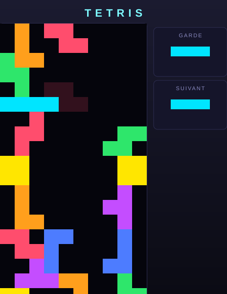

# Tetris en JavaScript

Un Tetris complet en HTML/CSS/JavaScript pur, sans aucune dépendance : un seul fichier [`index.html`](index.html).



## Jouer

Ouvre simplement `index.html` dans un navigateur (double-clic sur le fichier, aucune installation requise).

## Intégration WordPress

Ne colle **pas** le contenu de `index.html` dans une page WordPress : le filtre de contenu de WP découpe le HTML (`<p>`/`<br>` insérés dans le `<script>`) et le jeu ne démarre pas.

Deux méthodes propres :

**1. Plugin (recommandé)** — le dossier [`wordpress/tetris/`](wordpress/tetris/) contient un mini-plugin (`tetris.php`, `tetris.css`, `tetris.js`) :

1. Copie le dossier `tetris` dans `wp-content/plugins/` (FTP/SFTP ou un plugin de gestion de fichiers) ;
2. Active « Tetris » dans l'admin WordPress (*Extensions*) ;
3. Crée une page et mets-y le shortcode `[tetris]`.

**3. Plugin de JS personnalisé (type cjtoolbox) — comme le casse-brique** : le casse-brique fonctionne avec une page WordPress **vide** + un snippet JS pur qui construit tout le DOM lui-même. Fais pareil pour Tetris :

- vide complètement le contenu de la page `/tetris/` (supprime l'ancien HTML mutilé) ;
- dans `wp-admin/admin.php?page=cjtoolbox`, colle le contenu de [`wordpress/cjtoolbox/tetris-snippet.js`](wordpress/cjtoolbox/tetris-snippet.js) — **un seul fichier JS pur, jamais le HTML entier** : il injecte le CSS scopé + le markup dans `#tetris-game` et lance le jeu, uniquement sur les pages dont l'URL contient `/tetris/`.

(Variante manuelle en deux morceaux : [`page-markup.html`](wordpress/cjtoolbox/page-markup.html) dans un bloc « HTML personnalisé » de la page + [`game.js`](wordpress/cjtoolbox/game.js) dans le champ JS.)

### Dépannage cjtoolbox

- **Symptôme** : la page affiche le code JS en texte + des éléments de jeu en vrac → le snippet a été collé **dans le contenu de la page WordPress** au lieu du champ JS du plugin. WordPress (wpautop/wptexturize) détruit tout JS collé dans une page.
- **Fix** : vider entièrement la page `/tetris/` (comme la page casse-brique, vide) et coller `tetris-snippet.js` uniquement dans le champ JS de `wp-admin/admin.php?page=cjtoolbox`. Le snippet ne s'active que sur les URL contenant `/tetris/`.
- Si malgré tout ça ne marche pas : méthode la plus fiable, aucun JS à coller — upload `index.html` en statique (ex. `/tetris-game/index.html` via FTP) + bloc HTML personnalisé dans la page :
  ```html
  <iframe src="/tetris-game/index.html" width="500" height="700" style="border:0"></iframe>
  ```

**2. Fichier statique + iframe** — upload `index.html` tel quel à la racine du site (ex. `/tetris-game/index.html` via FTP), puis dans la page WordPress (bloc HTML personnalisé) :

```html
<iframe src="/tetris-game/index.html" width="500" height="700" style="border:0"></iframe>
```


## Contrôles

| Touche | Action |
| --- | --- |
| ← → | Déplacer la pièce |
| ↓ | Descente rapide |
| ↑ ou X | Tourner (horaire) |
| Z | Tourner (anti-horaire) |
| Espace | Chute instantanée |
| C | Garder la pièce (hold) |
| P | Pause |
| Entrée | Rejouer après une partie terminée |
| Tactile | glisse ← → : déplacer · tape : tourner · glisse ↓ vite : chute instantanée · boutons sous le plateau |

Sur mobile / écran tactile, des boutons tactiles apparaissent sous le plateau.

## Fonctionnalités

- Grille 10 × 20 et les 7 té trominos, avec distribution aléatoire « 7-bag »
- Rotations avec wall kicks et aperçu de la position d'atterrissage (pièce fantôme)
- Score, lignes et niveaux : la vitesse augmente tous les 10 lignes
- Aperçu de la pièce suivante et pièce gardée
- Pause, game over et redémarrage
- Interface adaptée aux petits écrans et aux écrans tactiles
