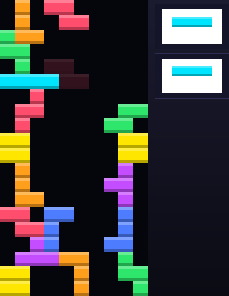

# Tetris en JavaScript

Un Tetris complet en HTML/CSS/JavaScript pur, sans aucune dépendance : un seul fichier [`index.html`](index.html).

## Jouer

Ouvre simplement `index.html` dans un navigateur (double-clic sur le fichier, aucune installation requise).

## Contrôles

| Touche | Action |
| --- | --- |
| ← → | Déplacer la pièce |
| ↓ | Descente rapide |
| ↑ ou X | Tourner (horaire) |
| Z | Tourner (anti-horaire) |
| Espace | Chute instantanée |
| C | Garder la pièce (hold) |
| P | Pause |
| Entrée | Rejouer après une partie terminée |

Sur mobile / écran tactile, des boutons tactiles apparaissent sous le plateau.

## Fonctionnalités

- Grille 10 × 20 et les 7 té trominos, avec distribution aléatoire « 7-bag »
- Rotations avec wall kicks et aperçu de la position d'atterrissage (pièce fantôme)
- Score, lignes et niveaux : la vitesse augmente tous les 10 lignes
- Aperçu de la pièce suivante et pièce gardée
- Pause, game over et redémarrage
- Interface adaptée aux petits écrans et aux écrans tactiles
